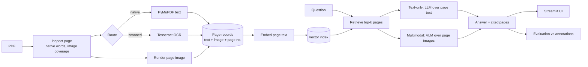

# VisualDoc AI — Multimodal Document Intelligence

VisualDoc AI is a project to answer questions about PDF documents (digital
and scanned) with **verifiable citations to the source page**, and to
measure, through a controlled evaluation, **when looking at the page image
helps compared with reading only the extracted text**.

> **Project status: foundation, evaluation design, and reusable parsing.**
> No question-answering pipeline exists yet. The repository currently has a
> tested native/OCR page parser, PDF experiments, course-reference notebooks,
> and the evaluation dataset format. The [status table](#implemented-vs-planned)
> separates what works from what is planned.

---

## 1. Motivation and problem statement

Most "chat with your PDF" systems convert each page to text, split it into
chunks, retrieve the chunks most similar to the question, and give them to a
language model. This works for prose, but a PDF page is a set of drawing
instructions, not a structured document. The experiments in this repository
show concrete failures of the text route:

- **Figures stored as images carry no extractable text.** On `data/documents/ch2.pdf`
  page 65, the plotted curves and their labels exist only as pixels; native
  extraction returns only the caption.
- **Tables lose their structure.** On `data/documents/ch2.pdf` page 49, PyMuPDF's
  `find_tables()` detects a table but returns it as a single column.
- **Equations are mangled.** The integral sign in the TeX font CMEX comes out
  as the letter `R`; a fraction comes out as `m(x)1`.
- **Scanned pages contain no text at all** until OCR is run, and simple
  heuristics can be fooled: `data/documents/scanned.pdf` page 1 has one native heading
  drawn over a full-page scan.

Vision-language models (VLMs) can read a rendered page image directly, which
should help on exactly these cases — but they are slower, more expensive,
and their claims are harder to verify. The project asks where the trade-off
is worth it, and builds a system that cites the pages it used so answers can
be checked.

## 2. Objectives and expected outcomes

1. A parsing stage that handles both born-digital and scanned PDFs, choosing
   native extraction or OCR per page.
2. Page-level semantic retrieval that returns the evidence pages for a
   question.
3. Two answer generators over the same retrieved pages: **text-only** (LLM
   over extracted text) and **multimodal** (VLM over page images).
4. Answers with **page citations** that link back to the source.
5. A small, human-verified evaluation set and a report comparing the two
   generators by question type and evidence type.
6. A minimal Streamlit interface to upload a PDF, ask a question, and see the
   answer next to the cited pages.

## 3. MVP scope and limitations

**In scope:** English PDFs (born-digital and scanned); questions about a
single document; text, tables, figures, equations and scanned text as
evidence; page-level citations; local single-user app.

**Out of scope for the MVP:** cross-document questions; handwriting;
image-only inputs (JPG/PNG — explored in `notebooks/course_labs/`, not in the MVP); open-ended
summaries; region-level (bounding-box) citations; fine-tuning; multi-user
deployment.

**Known limitations to expect:**

- The evaluation set will be small (target 60–100 questions), so only
  large differences between methods will be distinguishable from noise.
- Both generators will likely depend on paid APIs; costs and model versions
  must be recorded with each run for results to be reproducible.
- A single annotator (with a delayed second pass) is weaker than two
  independent annotators. This will be stated in the results.

## 4. Proposed architecture (planned)



The **page** is the unit of retrieval and citation. This keeps citations
simple to verify (the annotation set records evidence pages) and lets the
same retrieved pages be given to either generator, which the evaluation
requires. Only the first stage (inspect → route → extract) has been
prototyped, in `notebooks/prototypes/page_extraction.ipynb`.

## 5. Technologies

| Technology | Purpose | Status |
| --- | --- | --- |
| [PyMuPDF](https://pymupdf.readthedocs.io/) | Text, words, fonts, images, tables from PDFs; page rendering | Prototyped in notebooks |
| Tesseract (via PyMuPDF, `resources/tessdata/eng.traineddata`) | OCR for scanned pages | Prototyped in notebooks |
| pandas, pytest | Annotation files and their schema checks | Implemented (`tests/`) |
| PaddleOCR, LayoutReader, LandingAI ADE | Alternative OCR, layout, reading order, agentic extraction | Explored in `notebooks/course_labs/` only; candidates for hard pages |
| ChromaDB | Vector store for retrieval | Used in `notebooks/course_labs/L5`; planned for the MVP |
| Embedding model | Semantic page retrieval | Planned; **not chosen yet** |
| OpenAI API (`openai`, `langchain-openai`) | LLM / VLM answer generation | Used in `notebooks/course_labs/`; provider for the MVP **not finalized** |
| Streamlit | User interface | Planned; not installed |

## 6. Research question and evaluation strategy

**Research question.** On the same documents, questions and retrieved pages,
does giving the model **page images** instead of **extracted text** improve
answer accuracy and citation correctness — and for which kinds of evidence
(text, tables, figures, equations, scanned text)?

**Expectation to test** (not a result): little difference on plain-text
questions; a multimodal advantage on figures and tables; scanned text depends
on OCR quality.

**Controlled design.** Only the generator's input changes between
conditions. Held constant: questions, documents, retriever, number of pages
*k*, prompt template, temperature, and — where possible — the model itself
(one model that accepts both text and images).

| | Retrieved pages (top-*k*) | Oracle pages (annotated evidence) |
| --- | --- | --- |
| **Text input** | end-to-end text-only | text-only reading ability |
| **Image input** | end-to-end multimodal | multimodal reading ability |

The oracle column gives each generator the correct pages, which separates
"the retriever missed the page" from "the model misread the page".

**Metrics.**

- *Retrieval:* page Hit@*k* — is any annotated evidence page in the top *k*?
- *Answer correctness:* numbers within tolerance; short answers by
  normalized match, checked manually; graded blind to the condition.
- *Citation correctness:* does the answer cite at least one annotated
  evidence page?
- *Abstention:* on `unanswerable` questions, does the system say the answer
  is not in the document?

Results are reported per `evidence_modality` and `question_type`, with
counts, using paired comparisons on the same questions (e.g. McNemar's test
or bootstrap intervals). Prompts and settings are tuned on the `dev` split
only; the `test` split is used once for final numbers.

**Dataset.** See [`data/annotations/README.md`](data/annotations/README.md)
for the schema and labelling workflow. `questions.csv` is currently
**empty**; the three documents in `documents.csv` are **candidates**, not yet
selected.

## 7. Roadmap (tentative)

| Day | Milestone |
| --- | --- |
| 1 | ✅ Project foundation: README, structure, annotation schema and guide, environment review |
| 2 | ✅ Move the parsing prototype into `src/visualdoc/parsing.py` with unit tests; page record still pending |
| 3 | Parse the selected documents into page records; start writing questions |
| 4 | Embeddings + vector index; measure page Recall@*k* on `dev` |
| 5 | Text-only answer generation with page citations |
| 6 | Page rendering + VLM answer generation (multimodal condition) |
| 7 | Evaluation harness: run the four conditions, store runs, score |
| 8 | Finish and verify annotations; freeze the `test` split |
| 9 | Improve weak cases (tables, figures) using `dev` only |
| 10 | Streamlit app: upload, ask, answer with cited page images |
| 11 | Final evaluation on `test` |
| 12 | Error analysis |
| 13 | Documentation, tests, cleanup |
| 14 | Buffer and demo |

## 8. Implemented vs planned

| Component | Status | Where |
| --- | --- | --- |
| PDF anatomy study (text, spans, images, tables, OCR) | ✅ Experiment | `notebooks/experiments/pdf_anatomy.ipynb` |
| Per-page routing: native / OCR / hybrid / review | ✅ Implemented; original prototype retained | `src/visualdoc/parsing.py`, `notebooks/prototypes/page_extraction.ipynb` |
| OCR, layout, ADE, ADE-based RAG course labs | ✅ Learning material | `notebooks/course_labs/` |
| Annotation schema, guide, schema tests | ✅ Implemented | `data/annotations/`, `tests/` |
| Verified evaluation questions | ⏳ Not started (needs a human annotator) | `data/annotations/questions.csv` |
| Reusable parsing module | ✅ Implemented and tested | `src/visualdoc/parsing.py`, `tests/test_parsing.py` |
| Retrieval, text-only and multimodal QA, citations | ⏳ Planned | — |
| Evaluation runs | ⏳ Planned | `experiments/` |
| Streamlit app | ⏳ Planned | — |

## 9. Repository layout

```text
.
├── README.md                       # project overview and usage
├── pyproject.toml                  # package metadata and core/dev dependencies
├── requirements.txt               # compatibility installer
├── requirements/labs.txt          # optional heavy course-lab dependencies
├── data/
│   ├── documents/                  # three evaluation document candidates
│   └── annotations/                # dataset schema, guide, and CSV files
├── resources/tessdata/             # local Tesseract language models
├── src/visualdoc/parsing.py        # reusable inspection, routing, and OCR
├── tests/                          # annotation and parsing tests
├── notebooks/
│   ├── experiments/                # executed PDF anatomy study
│   ├── prototypes/                 # original page-routing prototype
│   └── course_labs/                # external learning/reference material
├── experiments/                    # future controlled evaluation runs
└── docs/                           # technical map and agent-skill notes
```

## 10. Setup

Tested environment: Python 3.12.6 on macOS (Apple Silicon).

```bash
# from the repository root
python3.12 -m venv .venv
source .venv/bin/activate
pip install -r requirements.txt

cp .env.example .env          # then fill in the keys you need
```

For the optional course labs, also install:

```bash
pip install -r requirements/labs.txt
```

Extra, non-pip requirements used only by some course labs:

- `notebooks/course_labs/L1.ipynb` uses `pytesseract`, which needs the Tesseract binary:
  `brew install tesseract`. The project notebooks do **not** need it; they use
  the OCR engine built into PyMuPDF with `resources/tessdata/`.
- `notebooks/course_labs/L3.ipynb` needs LayoutReader, which is not on PyPI:
  `git clone https://github.com/ppaanngggg/layoutreader.git notebooks/course_labs/layoutreader`
  (already git-ignored).

API keys (see `.env.example`):

| Key | Needed by |
| --- | --- |
| `OPENAI_API_KEY` | `notebooks/course_labs/L1`, `L2`, `L3`, `L5` |
| `VISION_AGENT_API_KEY` (LandingAI) | `notebooks/course_labs/L4`, `L4_II`, `L5` |

The project notebooks and the tests need no API key.

## 11. Running what exists

**Tests** (from the repository root; expected: all pass):

```bash
pytest tests/ -v
```

**Project experiments** — paths are resolved from the repository root, so
start Jupyter anywhere inside the checkout:

```bash
jupyter lab
```

Open `notebooks/experiments/pdf_anatomy.ipynb` or `notebooks/prototypes/page_extraction.ipynb` and select the
`.venv` kernel (the saved notebook metadata names a `conda` kernel).

**Course notebooks** — start Jupyter from their directory because these
imported notebooks intentionally use lesson-relative paths:

```bash
cd notebooks/course_labs
jupyter lab
```

They call `load_dotenv()`, which searches parent folders, so a `.env` at the
repository root should be found.

## 12. Data and licensing notes

`documents.csv` records the provenance and usage rights of every document.
Anything committed here is public: check `usage_rights` before adding a
document, and do not commit private or confidential PDFs. See
[`THIRD_PARTY_NOTICES.md`](THIRD_PARTY_NOTICES.md) for unresolved licensing
and redistribution notes.
