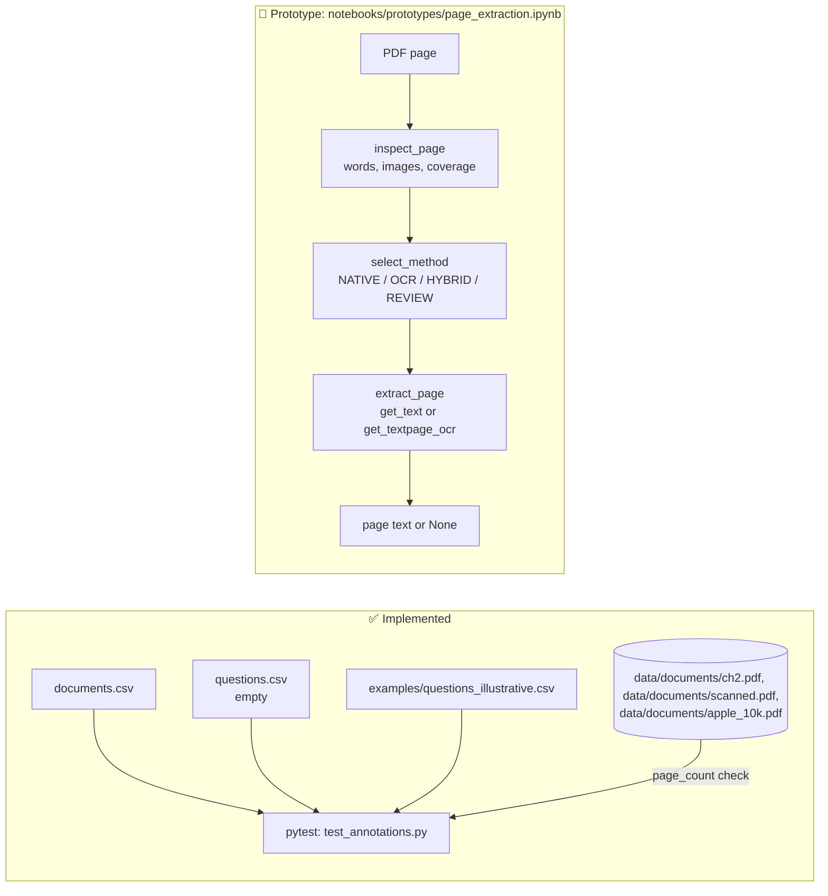
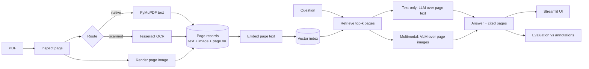
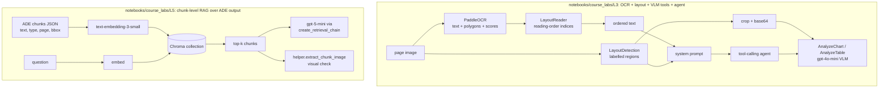
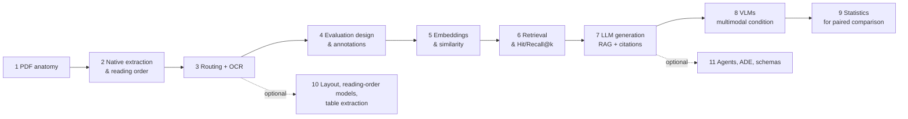

# Technical Knowledge Map — VisualDoc AI

A study guide and architecture reference for this repository. It explains
**what** each technical component is, **why** the project needs it, **how** it
works, **where** it appears in the code, and **how to check** that it behaves
as claimed.

> **Snapshot:** written on 2026-11-18 and updated after the repository cleanup
> and parser extraction described in [`README.md`](../README.md).
> Every "this repository does X" statement was checked against the code. Most
> numbers come from saved notebook outputs or from commands re-run for this
> document (Python 3.12.6, PyMuPDF 2.1, paddleocr 3.7.0, chromadb 1.5.9,
> langchain 0.3.30). The two exceptions are labelled where they appear: the
> behaviour of the course labs is taken from the course's own notes, and the
> OpenAI embedding-norm property is taken from OpenAI's documentation.

---

## Contents

0. [How to read this document](#0-how-to-read-this-document)
1. [The project in one page](#1-the-project-in-one-page)
2. [Technical hierarchy and architecture](#2-technical-hierarchy-and-architecture)
3. [Foundations: what a PDF page really contains](#3-foundations-what-a-pdf-page-really-contains)
4. [Parsing: from page to text](#4-parsing-from-page-to-text)
5. [Understanding: language and vision-language models](#5-understanding-language-and-vision-language-models)
6. [Retrieval: embeddings, vector search, RAG](#6-retrieval-embeddings-vector-search-rag)
7. [Grounding and evaluation](#7-grounding-and-evaluation)
8. [Supporting libraries](#8-supporting-libraries)
9. [The complete workflow, stage by stage](#9-the-complete-workflow-stage-by-stage)
10. [Technical comparisons](#10-technical-comparisons)
11. [Pitfalls and corrections found during this analysis](#11-pitfalls-and-corrections-found-during-this-analysis)
12. [Learning and implementation roadmap](#12-learning-and-implementation-roadmap)
13. [Glossary](#13-glossary)
14. [References](#14-references)

---

## 0. How to read this document

### Status labels

Every component carries one of these labels. They answer one question: *what
evidence exists in the repository?*

| Label | Meaning | Evidence required |
| --- | --- | --- |
| ✅ **Implemented** | Executable project code outside notebooks, covered by tests. | A `.py` file that runs and is tested. |
| 🧪 **Prototype** | The project's own experiments, run in this repository. | A project notebook with saved outputs. |
| 📘 **Course lab** | Explored in the `notebooks/course_labs/` notebooks (DeepLearning.AI course material). A sub-type of *experimental*. | Code exists, but was **not run here**: the L2–L5 notebooks have no saved outputs and L1 has one. Claims about their results come from the course's own notes. |
| ⏳ **Planned** | Promised in `README.md` or this map. | Documentation only, no code. |
| 💡 **Recommended** | Proposed in this document. Not part of the project. | None. Treat it as advice. |

**Important:** an installed library is not an implemented feature. Streamlit,
for example, is planned but not installed.

### What exists today, in one paragraph

The tested project code consists of the evaluation-annotation schema and its
checks ([`tests/test_annotations.py`](../tests/test_annotations.py)), plus the
reusable parsing module and regression tests
([`src/visualdoc/parsing.py`](../src/visualdoc/parsing.py),
[`tests/test_parsing.py`](../tests/test_parsing.py)). The three parsing
functions originated in
[`notebooks/prototypes/page_extraction.ipynb`](../notebooks/prototypes/page_extraction.ipynb),
and their behaviour is explained by the experiments in
[`notebooks/experiments/pdf_anatomy.ipynb`](../notebooks/experiments/pdf_anatomy.ipynb).
OCR alternatives, layout analysis, VLMs, agents, vector search and RAG appear
**only** in the course labs. Retrieval, answer generation, citations,
evaluation runs and the user interface are **planned**.

---

## 1. The project in one page

**Goal.** Answer questions about PDFs (born-digital and scanned) with
**page-level citations**. Then measure, in a controlled experiment, **when
giving the model the page image beats giving it the extracted text**.

**Key design decision.** The **page** is the unit of retrieval and citation
(README §4). Two reasons:

1. The annotations record `evidence_pages`, so a page citation can be scored
   automatically.
2. The same retrieved pages can be fed to either a text-only or an image-based
   generator. The comparison then isolates one variable: the input modality.

**Why the question matters.** The project experiments show four concrete
failures of the text route on this project's own documents:

| Failure | Where it was shown | What goes wrong |
| --- | --- | --- |
| Figure stored as pixels | `data/documents/ch2.pdf` p.65 | Native extraction returns only the caption: 39 words. |
| Table structure lost | `data/documents/ch2.pdf` p.49 | `find_tables()` returns 16 rows × **1** column. |
| Math glyphs mis-mapped | `data/documents/ch2.pdf` p.9 | `∫` becomes `R`, `∑` becomes `P`, and a fraction becomes `m(x)1`. |
| Scan with a stray text layer | `data/documents/scanned.pdf` p.1 | Only `'SAMPLE LETTER\n'` is native. The body exists only as pixels. |

| Component | Status | Where |
| --- | --- | --- |
| Annotation schema, guide, schema tests | ✅ | `data/annotations/`, `tests/` |
| PDF anatomy study | 🧪 | `notebooks/experiments/pdf_anatomy.ipynb` |
| Per-page routing: native / OCR / hybrid / review | ✅ + 🧪 | `src/visualdoc/parsing.py`; original notebook prototype |
| Tesseract via pytesseract, PaddleOCR, layout detection, LayoutReader, VLM tools, agents | 📘 | `notebooks/course_labs/L1`–`L3` |
| LandingAI ADE parse/extract, Chroma + OpenAI embeddings RAG | 📘 | `notebooks/course_labs/L4`, `L4_II`, `L5` |
| Reusable parsing module | ✅ | `src/visualdoc/parsing.py`, `tests/test_parsing.py` |
| Page record | ⏳ Day 2–3 | Proposed below; not implemented |
| Embeddings, vector index, Recall@k | ⏳ Day 4 | — |
| Text-only and multimodal answers with citations | ⏳ Days 5–6 | — |
| Evaluation harness | ⏳ Day 7 | `experiments/` (README only) |
| Streamlit UI | ⏳ Day 10 | — |

---

## 2. Technical hierarchy and architecture

### 2.1 Eight categories that should not be confused

| Category | Definition | Example in this project | Common confusion |
| --- | --- | --- | --- |
| **Field** | A research area. | Document AI, computer vision, NLP, information retrieval, multimodal AI | — |
| **Concept** | An idea or representation used to reason about the problem. | Bounding box, embedding, reading order, grounding | "Embedding" is a representation, not a model. |
| **Task** | A problem to solve: inputs → desired outputs. | OCR, layout analysis, table recognition, retrieval, question answering | "OCR" is a task. Tesseract is one *tool* that performs it. |
| **Method** | A general strategy for solving a task. | Per-page routing, RAG, chunking, schema-based extraction, tool-calling agents | RAG is a method. LangChain only *helps implement* it. |
| **Algorithm** | A precise, step-by-step procedure. | Cosine similarity, BM25, HNSW search, CTC decoding, McNemar's test | HNSW is an algorithm. ChromaDB is a tool that *uses* it. |
| **Model / architecture** | A learned function, or the blueprint of that function. | Transformer (architecture), LayoutLMv3, PP-OCR models, `text-embedding-3-small`, GPT models | A model is not the API used to call it. |
| **Tool / library** | Code you call. | PyMuPDF, Tesseract, PaddleOCR, ChromaDB, NumPy, pandas, pytest | — |
| **Framework / service** | Code that structures *your* code, or a hosted product. | LangChain (framework), PyTorch (framework), OpenAI API and LandingAI ADE (hosted services) | ADE is a *service* built on proprietary models. Its internals are not public. |

### 2.2 Hierarchy tree

Read top to bottom: field → task → method or algorithm → model → tool. The
labels give the status in this repository.

```text
Document AI  (field: intersection of CV, NLP, IR)
│
├── PDF representation  (concepts)
│     page = drawing instructions · coordinates & bounding boxes · DPI
│     raster vs vector content · glyph → Unicode mapping
│
├── Document parsing
│   ├── Native text extraction (task)
│   │     └── PyMuPDF get_text("text"/"words"/"dict")            🧪
│   ├── Digital-vs-scanned detection (task)
│   │     └── Per-page routing heuristic (method)                 🧪 notebooks/prototypes/page_extraction.ipynb
│   │           inspect_page → select_method → extract_page
│   ├── OCR (task)
│   │   ├── Tesseract (tool; LSTM recognizer)
│   │   │     ├── via PyMuPDF get_textpage_ocr (partial/full)     🧪
│   │   │     └── via pytesseract image_to_string                 📘 L1
│   │   └── PaddleOCR (tool; PP-OCR detector + recognizer)        📘 L2, L3
│   │         algorithms: DB text detection, CTC recognition
│   ├── Layout analysis (task)
│   │     ├── PyMuPDF block/line/span hierarchy (heuristic)       🧪
│   │     └── PaddleOCR LayoutDetection (model)                   📘 L2, L3
│   ├── Reading order (task)
│   │     ├── Geometric sort: get_text(sort=True)                 🧪
│   │     └── LayoutReader = LayoutLMv3 token classifier (model)  📘 L3
│   └── Table extraction (task)
│         ├── PyMuPDF find_tables (rule/geometry based)          🧪 (fails on p.49)
│         ├── VLM prompt "AnalyzeTable"                          📘 L3
│         └── LandingAI ADE parse (hosted)                       📘 L4
│
├── Document understanding  (NLP + multimodal AI)
│   ├── Transformer (architecture) → LLMs, VLMs (models)          📘 L1–L5
│   ├── Tool-calling agent (method) · LangChain AgentExecutor     📘 L1–L3
│   ├── Schema-based extraction (method) · JSON Schema, Pydantic  📘 L4, L4_II
│   └── Text-only vs multimodal answering (research comparison)   ⏳ Days 5–7
│
├── Information retrieval
│   ├── Embeddings (concept) · text-embedding-3-small (model)     📘 L5 · ⏳ model not chosen
│   ├── Similarity: cosine / L2 (algorithms)                      📘 L5
│   ├── Approximate nearest neighbour: HNSW (algorithm) in Chroma 📘 L5 · ⏳
│   ├── Metadata filtering (called "hybrid" in L5)                📘 L5
│   ├── BM25 / true hybrid retrieval                              💡
│   └── RAG (method) · LangChain create_retrieval_chain           📘 L5 · ⏳
│
└── Grounding & evaluation
      ├── Page citations (method)                                 ⏳
      ├── Chunk/box grounding                                     📘 L4, L5
      ├── Annotation schema + pytest validation                   ✅
      └── Metrics: Recall@k, accuracy, citation correctness,
          abstention; paired tests (McNemar, bootstrap)           ⏳
```

### 2.3 Architecture diagrams

**(A) What runs today.** Only the top box is tested code.



**(B) Planned MVP.** This reproduces README §4, the explicitly proposed
architecture.



**(C) The two most relevant course pipelines (📘).**



---

## 3. Foundations: what a PDF page really contains

These concepts explain almost every failure observed in the experiments. Learn
them first.

### 3.1 A PDF page is a list of drawing instructions — *concept*

**What is it?** A PDF page is defined by a *content stream*: a sequence of
operators such as "select font F at size s", "show these glyphs at (x, y)",
"stroke this path" and "paint image I in this rectangle". In simple terms, a
PDF says *where ink goes*. It does not say *what the ink means*.

**Why it matters here.** "Paragraph", "table", "equation" and "figure" are
things a *reader* sees. The file usually stores none of them as such. So
every parser must *reconstruct* structure from geometry. Each reconstruction
can fail.

**Evidence.** In [`notebooks/experiments/pdf_anatomy.ipynb`](../notebooks/experiments/pdf_anatomy.ipynb)
§4, the fraction $\frac{1}{m(x)}$ on `data/documents/ch2.pdf` p.9 is just two small spans at
different heights. The `1` is at $y_0 = 65.21$ and the `m` at $y_0 = 71.83$.
Nothing in the file says "numerator".

**Counterexample.** *Tagged* PDFs (PDF/UA) can carry a structure tree:
headings, tables, reading order. LaTeX Beamer and scanners usually don't
produce one. Neither test document is tagged, so you cannot rely on tags.

### 3.2 Coordinates, bounding boxes and resolution — *concept*

**Definition.** A bounding box is an axis-aligned rectangle
$(x_0, y_0, x_1, y_1)$ that encloses an object. PyMuPDF measures in **PDF
points** ($1\ \text{pt} = 1/72$ inch). The origin is the **top-left** corner
and $y$ increases **downwards**. (The raw PDF format uses a bottom-left
origin, and PyMuPDF converts it.)

**Rendering.** To rasterise a page at a given resolution, multiply every
coordinate by

$$
s = \frac{\text{dpi}}{72}, \qquad x_{\text{px}} = s \cdot x_{\text{pt}} .
$$

At 144 dpi, $s = 2$. At the 200 dpi used for OCR, $s \approx 2.78$.
The notebook computes this factor from the pixmap size
(`scale_x = pixmap.width / page_rect.width`) instead of hard-coding it.

**Effective resolution of an embedded image.** The image's pixel width
divided by its displayed width in inches:

$$
\text{dpi}_{\text{eff}} = \frac{w_{\text{px}}}{w_{\text{pt}}/72} = \frac{1275}{612/72} = 150
$$

for the scan in `data/documents/scanned.pdf`. Rendering it at 200 dpi for OCR *upsamples*
it. Tesseract gets larger glyphs but no new detail.

**Three box formats you will meet:**

| Format | Example | Source |
| --- | --- | --- |
| `(x0, y0, x1, y1)` in points | `get_text("words")` | PyMuPDF |
| 4-point polygon in pixels `[[x1,y1],…,[x4,y4]]` | `rec_polys`, `dt_polys` | PaddleOCR (handles rotated text) |
| Normalised to $[0, 1]$ or $[0, 1000]$ | ADE chunks (0–1); LayoutReader input (0–1000) | L5 JSON; L3 `get_reading_order` |

Converting between them correctly is a classic source of bugs. Examples:
pixels vs points, 0- vs 1-based pages, and the `x1,y1` corner vs a width and
height.

### 3.3 Raster vs vector content — *concept*

- **Raster image:** a grid of pixels. Text inside it is invisible to native
  extraction.
- **Vector drawing:** paths (lines, curves, fills) stored as geometry.

Two plots can look the same on screen and be completely different to a
parser. `data/documents/ch2.pdf` p.17 has **0** raster images and **67** vector drawings.
Its plots are geometry, but their tick labels are real text. p.65 is the
opposite: the whole figure, labels included, is one **4346 × 2536 px** image.

### 3.4 Glyphs, fonts and Unicode mapping — *concept*

**What it is.** A PDF shows *glyphs* (shapes) selected by *codes* in a font.
To extract text, the parser needs a map from code to Unicode, usually a
`ToUnicode` table. If the map is missing, the raw code comes out.

**Repository evidence.** In TeX's CMEX font, the large integral sits at code
0x52, which is ASCII `R`. The large sum (∑) likewise comes out as `P`
([`notebooks/experiments/pdf_anatomy.ipynb`](../notebooks/experiments/pdf_anatomy.ipynb) §2 and §5). Missing
spaces such as `θ ∈[0, 10]` have a related cause. TeX positions math with
horizontal shifts, not space characters, so PyMuPDF must *infer* spaces from
gaps.

**Consequence for the project.** Questions with `evidence_modality =
equation` should be expected to fail on text-only input. This is why that
label exists in the annotation schema.

---

## 4. Parsing: from page to text

### 4.1 PyMuPDF — *tool / library* · 🧪 (also used in tests ✅ and labs 📘)

**What is it?** PyMuPDF is the Python binding of **MuPDF**, a C library for
parsing and rendering PDF and other document formats. It is imported as
`pymupdf`. Legacy code imports it as `fitz`, as [`notebooks/course_labs/helper.py`](../notebooks/course_labs/helper.py)
does. In simple terms, it opens a PDF and lets you read text with positions,
list images and drawings, find tables, render pages to images, and run OCR.

**Why is it needed?** It is the project's single entry point to PDFs. Every
later stage starts from what PyMuPDF returns.

**How does it work?** MuPDF interprets each page's content stream. A
*device* records the result: a text device builds a `TextPage` (blocks →
lines → spans → characters with boxes), and a draw device rasterises to a
`Pixmap`. The extraction modes are different *views* of the same `TextPage`:

| Call | Returns | Used in |
| --- | --- | --- |
| `page.get_text("text")` | Plain string in content-stream order | `extract_page` (NATIVE) |
| `page.get_text("text", sort=True)` | Same, re-ordered top-left → bottom-right | experiment §2 |
| `page.get_text("words")` | Tuples `(x0,y0,x1,y1,word,block,line,word_no)` | `inspect_page`, experiment §3 |
| `page.get_text("dict")` | Nested dict: blocks → lines → spans (font, size, bbox) | experiment §4 |
| `page.get_image_info()` | Displayed images: pixel size and **placement bbox** | `inspect_page`, experiment §5–6 |
| `page.get_drawings()` | Vector paths | experiment §5 |
| `page.find_tables()` | Detected tables, `.extract()` → rows | experiment §5 |
| `page.get_pixmap(dpi=…)` | Rendered raster image | experiment, `notebooks/course_labs/helper.py` |
| `page.get_textpage_ocr(...)` | A `TextPage` built by Tesseract | `extract_page` (OCR/HYBRID) |

**How is it used in this repository?**

- `inspect_page(page)` ([`notebooks/prototypes/page_extraction.ipynb`](../notebooks/prototypes/page_extraction.ipynb)):
  page → `{"native_words", "image_count", "largest_image_fraction"}`.
- `extract_page(page, method)` returns text or `None`.
- `test_documents_match_pdf_files` ([`tests/test_annotations.py`](../tests/test_annotations.py))
  opens each PDF and checks that `page_count` matches `documents.csv`.
- `pixmap_to_array` (experiment setup) turns a `Pixmap` into a NumPy array
  (§8).

**Connections.** It is upstream of everything: routing, OCR, page rendering
for VLMs (planned) and chunk cropping (`notebooks/course_labs/helper.extract_chunk_image`).

**Alternatives.**

| Tool | Prefer when |
| --- | --- |
| pdfplumber / pdfminer.six | You need detailed character-level control in pure Python. They are slower and do no rendering. |
| pypdf | You only need simple text and metadata, or page manipulation. |
| Docling 💡 | You want layout, reading order and table structure out of the box (§10.1). |
| Hosted parsers (ADE, cloud OCR) | You can send documents out and pay per page (§5.5). |

**Limitations.** It cannot recover semantics the file doesn't contain
(equations, table structure). Its "words" are whitespace-delimited runs. And
`find_tables()` relies on ruling lines and text alignment, which failed on
p.49.

**Validation.** Draw the boxes on the rendered page. This is experiment §3:
the 25 red boxes fit the words tightly. If they are shifted, your scale or
origin is wrong.

### 4.2 Native text extraction and geometric reading order — *task + heuristic* · 🧪

**What is it?** Reading the characters already stored in the file, and putting
them in the order a human reads them.

**Why needed?** For born-digital pages, it is exact (no recognition errors),
fast, and free. It is the default route.

**How it works.** Default mode emits text in **content-stream order**, the
order the producer wrote it. `sort=True` sorts lines by $(y_0, x_0)$, top to
bottom and then left to right.

**Evidence of the trade-off** (experiment §2, `data/documents/ch2.pdf` p.9):

| Mode | Fraction $\frac{1}{m(x)}$ comes out as | Why |
| --- | --- | --- |
| default | `1` / `m(x)` on separate lines | Written as separate, vertically offset pieces |
| `sort=True` | `m(x)1` | `m` starts at $x_0 = 237.02$, left of `1` at $x_0 = 241.89$ |

**Limitations.** Geometric sorting assumes a single column. It reads straight
across multi-column layouts, the same problem the course shows for PaddleOCR
on `article.jpg` (L2 notes). No ordering can rebuild an equation (§3.1).

**Validation.** For a page, compare the default and sorted outputs with the
rendered page. Count lines that are out of order.

### 4.3 Per-page routing: digital vs scanned detection — *method* · ✅ + 🧪

This is the heart of the existing parser. The reusable implementation lives
in [`src/visualdoc/parsing.py`](../src/visualdoc/parsing.py); the original
exploratory version remains in
[`notebooks/prototypes/page_extraction.ipynb`](../notebooks/prototypes/page_extraction.ipynb).

**What is it?** A rule-based classifier that decides, **for each page**,
whether to read the native text, run OCR, combine both, or flag the page for
a human.

**Why needed?** Real PDFs mix page types. OCR on a born-digital page is slow
and can only *lose* accuracy. Native extraction on a scan returns nothing.
The decision must be per page, not per file: `data/documents/scanned.pdf` has a native
heading on p.1 only.

**How it works.**

*Features* (`inspect_page`):

$$
n_w = |\text{words}|, \qquad
f = \max_i \frac{\operatorname{area}(b_i \cap P)}{\operatorname{area}(P)}
$$

where $b_i$ is the placement box of image $i$ and $P$ is the page rectangle.
Intersecting with $P$ clips images that bleed off the page.

*Decision rule* (`select_method`):

```text
if f ≥ 0.90:                        # page is (almost) one big image
    n_w == 0      → OCR             # pure scan
    1 ≤ n_w < 20  → HYBRID          # scan + small native overlay (stamp, heading)
    n_w ≥ 20      → REVIEW          # scan + real text layer? (e.g. searchable PDF)
else:
    n_w > 0       → NATIVE
    n_w == 0      → REVIEW          # blank, vector-only, or a scan with margins
```

*Extraction* (`extract_page`):

- `NATIVE` → `get_text("text")`.
- `OCR` → `get_textpage_ocr(full=True)`.
- `HYBRID` → `get_textpage_ocr(full=False)`.
- `REVIEW` → `None`.

It checks that each `<lang>.traineddata` exists in `resources/tessdata/` before running
OCR, and raises `FileNotFoundError` otherwise.

**Inputs → outputs.** `pymupdf.Page` → features dict → method string → `str | None`.

**Observed results.** The notebook shows the sample pages. Rerunning the
same rules over all pages for this document gives:

| Document | Routing result |
| --- | --- |
| `data/documents/ch2.pdf` (68 p.) | 68 × NATIVE |
| `data/documents/scanned.pdf` (3 p.) | p.1 HYBRID, p.2–3 OCR |
| `data/documents/apple_10k.pdf` (74 p.) | 73 × NATIVE, 1 × REVIEW (p.13: 0 words, 0 images, 4 vector drawings) |

On `data/documents/scanned.pdf` p.1, HYBRID kept the exact native `SAMPLE LETTER` and raised
the word count from 2 (native) to 458.

**Limitations and failure cases.**

1. **Coverage measures placement area, not content.** New finding: on
   `data/documents/ch2.pdf` p.65 the 0.807 coverage comes from the **1 × 1 px** image,
   whose placement box spans most of the slide. The real 4346 × 2536 px
   figure covers only **0.476**. The page routes to NATIVE, which is correct
   for the caption but blind to the figure's content.
2. **Text inside figures on born-digital pages is never recovered.** That is
   a *figure* problem, not a *scan* problem. It is exactly what the multimodal
   condition is meant to test.
3. **Searchable scans** (a scan plus an invisible OCR text layer) give
   $f \approx 1$, $n_w \gg 20$ → REVIEW. The existing text layer may be
   usable, or may be poor OCR from the scanner.
4. **Hard-coded thresholds** (0.90, 20) were tuned on two documents.
5. **Word count says nothing about text *quality*.** Mis-mapped glyphs
   (`R` for ∫) still count as words.

**Alternatives.**

- Ratio features: text area / page area, or the fraction of characters with
  valid Unicode.
- A small learned classifier.
- "Always OCR": simple but slow, and lossy on digital text.
- "Always VLM": avoids the decision but is expensive.

**Validation.**

- Regression tests verify the known routes: `data/documents/scanned.pdf`
  p.1 → HYBRID, p.2 → OCR, and `data/documents/ch2.pdf` p.9 → NATIVE.
- A routing *confusion table* against `documents.csv`'s `source_kind`.
- 💡 A test that a page whose only large image is ≤ 2 px wide is not
  treated as image-covered.

### 4.4 OCR — *task* (general mechanism)

**Definition.** Optical character recognition converts an image of text into
machine-readable characters, usually with positions and confidence scores.

**How modern OCR works.** A typical pipeline:

1. **Pre-processing:** binarisation, deskewing, orientation correction,
   denoising.
2. **Layout / text detection:** find text regions or lines.
3. **Recognition:** turn each line image into a character sequence.
4. **Post-processing:** assemble lines into blocks, and optionally apply a
   dictionary or language model.

Most modern recognisers turn a line image into a sequence of feature vectors
$x_1..x_T$ with a CNN, an RNN or a Transformer. They then output, at each
step $t$, a distribution over characters plus a special *blank* symbol.
**CTC** (connectionist temporal classification) trains this without
character-level alignment. It sums over every alignment $\pi$ that collapses
to the label $y$:

$$
p(y \mid x) = \sum_{\pi \in \mathcal{B}^{-1}(y)} \prod_{t=1}^{T} p(\pi_t \mid x)
$$

Here $\mathcal{B}$ merges repeated characters and then deletes blanks. For
example, `--hh-e-ll-ll-oo` → `hello`. *Greedy decoding* takes the argmax at
each step and applies $\mathcal{B}$.

**Why it errs the way it does.** Recognition is local and visual. `$7.95` vs
`$7.99` (receipt, L1 notes), `10^20` → `1020` (L2 notes), and the circular
EPA logo producing `3SZ &` (experiment §7) all come from weak or ambiguous
pixel evidence. OCR has no notion of whether the output *makes sense*.

### 4.5 Tesseract — *tool (OCR engine)* · 🧪 via PyMuPDF, 📘 via pytesseract

**What is it?** An open-source OCR engine, originally from HP and later
developed by Google. Since version 4 it uses an **LSTM-based line
recognizer**. Page layout analysis remains largely classical: connected
components, tab-stop and column detection. Language knowledge comes from
`<lang>.traineddata` model files.

**Correction to the course notes.** L2 describes Tesseract as using
"hand-engineered features and procedural rules", with "text only" output.
That describes Tesseract 3. Tesseract 4+ uses a neural recognizer. It can
also return word boxes and confidences (`pytesseract.image_to_data`, hOCR,
or PyMuPDF's OCR `TextPage`).

**Two ways the repository calls it:**

| Route | Where | Needs | Output |
| --- | --- | --- | --- |
| `page.get_textpage_ocr(language="eng", dpi=200, full=…, tessdata=…)` | `notebooks/prototypes/page_extraction.ipynb`, experiment §7 | `resources/tessdata/eng.traineddata`. MuPDF includes Tesseract, so no separate binary. | A `TextPage` you read with `get_text(textpage=tp)`, positions included |
| `pytesseract.image_to_string(Image.open(path))` | `notebooks/course_labs/L1.ipynb` `ocr_read_document` | The `tesseract` binary (`brew install tesseract`) | Plain string |

**Partial vs full OCR** (experiment §7, verified on `data/documents/scanned.pdf` p.1):

| Mode | Mechanism | Effect on `SAMPLE LETTER` |
| --- | --- | --- |
| `full=False` (HYBRID) | Removes legible native text from a temporary copy, OCRs the rest, then appends the OCR text **after** the native text | Kept exactly, appears first |
| `full=True` (OCR) | OCRs the entire rendered page | Re-read from pixels, appears mid-text in Tesseract's order |

**Connections.** Called only when routing says OCR or HYBRID. Its text goes
to the same page record as native text (planned).

**Limitations.** Handwriting, low contrast (the faint date stamp → `PE.` /
`y` / `2016`), curved text (logos), complex tables, and multi-column order on
complicated layouts.

**Validation.** Character error rate on a page you transcribe by hand:

$$
\text{CER} = \frac{S + D + I}{N}
$$

where $S, D, I$ are the character substitutions, deletions and insertions
in the minimum edit alignment, and $N$ is the number of reference
characters. Word error rate (WER) is the same at the word level.

### 4.6 PaddleOCR — *tool + models (deep-learning OCR)* · 📘 L2, L3

**What is it?** An open-source OCR toolkit built on Baidu's PaddlePaddle
framework. Its PP-OCR models run as a pipeline: optional document
pre-processing (orientation, unwarping) → **text detection** (polygons) →
**text recognition** (string + confidence).

**How it works.**

- **Detection** in the PP-OCR family follows **DB (Differentiable
  Binarization)**. A segmentation network predicts a probability map $P$
  and a per-pixel threshold map $T$. The hard binarisation is replaced by a
  differentiable approximation, $\hat{B} = 1 / (1 + e^{-k(P - T)})$, so the
  threshold is learned end-to-end. Text regions are then extracted as
  polygons.
- **Recognition** uses a CRNN/SVTR-style line recognizer trained with CTC
  (§4.4).

**In this repository.** `PaddleOCR(lang='en')` then `ocr.predict(path)`
returns a list with one dict per page. It contains `rec_texts`,
`rec_scores`, `rec_polys` / `dt_polys`, and
`doc_preprocessor_res.output_img`. `paddle_ocr_read_document` (L2) converts
the polygons to `[x_min, y_min, x_max, y_max]` and returns
`[{text, bbox, confidence}]`.

*Version note:* with the installed `paddleocr 3.7.0`, `lang='en'` resolves
to the `PP-OCRv6_medium_det` / `PP-OCRv6_medium_rec` models (read from
`paddleocr/_pipelines/ocr.py`). The course was written for an earlier
version, so results can differ from its notes.

**Limitations (course notes).** Reads straight across columns
(`article.jpg`), detects axis labels without the chart as a region
(`report.png`), and handwriting is still hard.

**Validation.** The same CER/WER as Tesseract, on the same images. Also
check that the boxes overlay correctly, which the L2 visualisation does.

### 4.7 Layout analysis — *task* · 🧪 (heuristic) · 📘 (model)

**What is it?** Dividing a page into labelled regions (text, title, table,
chart, figure, footer, …), each with a box. Two approaches appear here:

1. **Heuristic (🧪):** PyMuPDF's blocks → lines → spans (experiment §4).
   These describe *typography* (same font, size and colour), not *roles*.
2. **Learned (📘):** `paddleocr.LayoutDetection()`, an object detector
   trained on annotated document pages. In the installed version its default
   model is `PP-DocLayout_plus-L`. It returns
   `boxes[i] = {label, score, coordinate}`. L2's `process_document` sorts
   the boxes by score. L3 stores them as `LayoutRegion(region_id, region_type,
   bbox, confidence)` and crops each region with `crop_region` for the VLM
   tools.

**Why needed?** It sends each region to the right processor: tables to table
extraction, charts to a VLM, text to OCR. It also stops text from different
columns being merged.

**Limitations.** A fixed label set, confidence thresholds (L2 uses
`min_confidence=0.5`), and region boxes that may overlap or miss captions.

**Validation.** Draw the boxes, as L2's `visualize_layout` does. For numbers,
use precision and recall at an IoU threshold against hand-drawn boxes:

$$
\text{IoU}(A, B) = \frac{|A \cap B|}{|A \cup B|}
$$

### 4.8 Reading-order prediction: LayoutReader / LayoutLMv3 — *model* · 📘 L3

**What is it?** **LayoutLMv3** is a Transformer pre-trained jointly on text,
layout (2-D positions) and image patches of documents. **LayoutReader**
(Wang et al., 2021) predicts reading order and was trained on
**ReadingBank** (≈500k pages). L3 uses the community checkpoint
`hantian/layoutreader`, loaded as `LayoutLMv3ForTokenClassification`, with
helpers from the cloned `ppaanngggg/layoutreader` repository
(`boxes2inputs`, `prepare_inputs`, `parse_logits`).

**How it works in L3 (`get_reading_order`).**

1. Convert each OCR polygon to `[x1, y1, x2, y2]` (the `OCRRegion.bbox_xyxy`
   property).
2. Normalise the boxes to a 0–1000 grid. L3 *estimates* the page size as
   $1.1 \times \max(x_2)$ and $1.1 \times \max(y_2)$ instead of using the
   true image size.
3. Feed **only the boxes** (no text) to the model as a sequence of tokens.
   For each box it outputs logits over positions.
4. `parse_logits` turns those logits into a unique ordering, resolving cases
   where two boxes claim the same position.

`get_ordered_text` then sorts the OCR regions by this order.

**Why needed?** It feeds the LLM text in a sensible order on multi-column or
irregular pages, where geometric sorting fails.

**Limitations.**

- It uses geometry only, so it misreads layouts whose order depends on
  content.
- It is bounded by the model's maximum sequence length (512 positions).
- The course notes warn of "non-sequential jumps".
- The estimated page size changes the 0–1000 normalisation.

**Validation.** On a page you order by hand, compute Kendall's $\tau$
between the predicted and true orders, or count adjacent pairs in the right
order.

### 4.9 Table extraction — *task* · 🧪 (fails) · 📘

**What is it?** Recovering a table's grid (rows, columns, headers, cells)
and not just its text.

| Approach | Where | Mechanism | Observed / claimed |
| --- | --- | --- | --- |
| `page.find_tables()` | experiment §5 | Ruling lines + text alignment → cell grid | `data/documents/ch2.pdf` p.49: 16 × **1** instead of 8 × 3. Absorbed the paragraphs above and below. The table has only horizontal rules. |
| VLM prompt `AnalyzeTable` | L3 | Crop the table region and ask a VLM for JSON headers and rows | "Works on simple tables, may hallucinate" (course notes) |
| ADE parse | L4 | Hosted model returns tables as HTML with cell IDs | Handles merged and borderless cells (course notes) |

**Validation.** Cell-level accuracy against a hand-made CSV of the table, or
TEDS (tree-edit-distance similarity) for structure. At minimum, check
`row_count × col_count` against the visible table. A non-zero table count
does not mean the structure was recovered.

---

## 5. Understanding: language and vision-language models

### 5.1 Transformer — *architecture*

**What is it?** A neural network made of stacked **self-attention** and
feed-forward layers that maps a sequence of vectors (tokens) to a sequence of
contextualised vectors. The key operation is:

$$
\operatorname{Attention}(Q, K, V) = \operatorname{softmax}\!\left(\frac{QK^\top}{\sqrt{d_k}}\right) V
$$

Each token builds a *query*. It compares that query with every token's
*key* and takes a weighted average of their *values*. Cost grows as
$O(n^2)$ in sequence length $n$. That is why context windows, chunking and
image-token counts matter.

**Where it appears.** LayoutLMv3 (L3), the GPT models (L1–L3, L5), the
OpenAI embedding model (L5), and likely ADE's DPT models (proprietary, so
unconfirmed).

### 5.2 LLMs and VLMs — *models* · 📘 · ⏳ provider not chosen

**Definitions.**

- A **large language model (LLM)** is a Transformer trained to predict the
  next token. After instruction tuning it follows prompts.
- A **vision-language model (VLM)** also accepts images. Typically a vision
  encoder (often a ViT) turns image patches into vectors, and a projector
  maps them into the LLM's token space.

An image of $H \times W$ pixels cut into $p \times p$ patches gives
$N = HW/p^2$ visual tokens, before any compression a provider applies. So
**resolution drives cost and latency**.

**Why needed here.** VLMs are the project's *treatment* condition. They
read the page image directly, including raster figures (p.65), table layout
(p.49) and scanned text, without trusting the text layer.

**In this repository (📘).**

| Notebook | Model | Settings | Role |
| --- | --- | --- | --- |
| L1, L2 | `gpt-5-mini` | `temperature=1` | Agent LLM reading OCR output |
| L3 | `gpt-4o-mini` | `temperature=0` | VLM tools and agent |
| L5 | `gpt-5-mini` | `temperature=1` | RAG answer generator |

L3's `call_vlm_with_image` sends a `HumanMessage` with two content parts: the
text prompt and `{"type": "image_url", "image_url": {"url":
"data:image/png;base64,…"}}`. The image is PNG-encoded in memory by
`image_to_base64`.

**Limitations.**

- Hallucination, especially on dense tables and precise chart values.
  L3 notes "data points are approximate".
- Non-determinism (`temperature=1`; model updates).
- Weak *spatial* precision.
- An answer can't be traced to pixels unless you ask for citations.

**Validation.** The planned four-condition design (README §6): the same
pages, given as text vs image, retrieved vs oracle. Record the model ID,
temperature and prompt for every run.

### 5.3 Tool-calling agents and LangChain — *method + framework* · 📘 L1–L3

**What is it?** An **agent** is an LLM in a loop. At each step it either
answers or emits a structured *tool call* (a function name plus JSON
arguments). The runtime executes the tool and appends the result. The
pattern descends from ReAct ("reason + act"). **LangChain** is a Python
framework that wraps prompts, models, tools and these loops.

**In this repository.**

- `@tool` turns a Python function into a tool. Its docstring becomes the
  description the LLM reads (`ocr_read_document`, `paddle_ocr_read_document`,
  `AnalyzeChart`, `AnalyzeTable`).
- `create_tool_calling_agent(llm, tools, prompt)` and
  `AgentExecutor(agent, tools)` run the loop. The prompt includes a
  `MessagesPlaceholder("agent_scratchpad")` that holds the previous tool
  calls and results.
- L3 places the **whole ordered OCR text** (first 50 regions) and the list
  of layout regions in the system prompt. The agent calls VLM tools only for
  tables and charts.

**Why it was used in the course.** In L1, regex on OCR text matched
`Sub Total` instead of `Total`. An LLM reading the same text understands the
difference.

**Trade-offs.** Agents are flexible but less predictable. The number of
calls varies, which makes cost and evaluation noisy. The MVP plan uses a
**fixed pipeline** (retrieve → generate) instead, which is easier to
evaluate. That is the right call for a controlled comparison.

**Version note.** The labs use `AgentExecutor`, `langchain.schema` and
`langchain.chains`, all removed in LangChain 1.0. Hence the `<1.0` pin in
[`requirements.txt`](../requirements.txt).

### 5.4 Schema-based structured extraction — *method* (JSON Schema, Pydantic) · 📘 L4, L4_II

**What is it?** You describe the output you want as a typed schema. The
model must fill it, giving machine-checkable output instead of free text.

- **JSON Schema** is a standard vocabulary for describing JSON (types,
  properties, descriptions).
- **Pydantic** defines the same thing as Python classes (`BaseModel`,
  `Field`, `Enum`) and validates data against them.

**In this repository.**

- L4 writes a nested JSON Schema for a utility bill.
- L4_II defines Pydantic classes (`DocType` with a `DocumentType` enum;
  `IDSchema`, `W2Schema`, `PaymentStubSchema`, `BankStatementSchema`,
  `InvestmentStatementSchema`). It converts them with
  `landingai_ade.lib.pydantic_to_json_schema` and selects the schema per
  document type through `schema_per_doc_type`.

The **field descriptions are effectively prompts**. A copy-paste error in
L4, where `electric_current_charges` is described as "The **gas** charges…",
can mislead the extractor (§11).

**Relevance to the MVP.** The planned **page record** and **answer +
citations** objects are natural Pydantic models (💡). They let you validate
that every answer carries at least one page number.

### 5.5 LandingAI Agentic Document Extraction (ADE) — *hosted service* · 📘 L4, L4_II, L5

**What is it?** A commercial API (the `landingai-ade` SDK; key
`VISION_AGENT_API_KEY`) with two main calls:

- `client.parse(document, model="dpt-2-latest", split=...)` returns a
  `ParseResponse`. It contains `markdown` (with chunk anchors), `chunks`
  (each with an `id`, a `type` such as `text`, `table`, `figure`, `logo`,
  `marginalia` or `attestation`, `markdown`, and `grounding.page` /
  `grounding.box`), and `splits` (per page when `split="page"`).
- `client.extract(schema, markdown)` returns an `ExtractResponse`. It
  contains `extraction` (values) and `extraction_metadata` (the chunk or
  table-cell IDs each value came from).

**How does it work?** LandingAI describes "Document Pre-trained Transformer"
(DPT) models with an agentic loop. Architecture, training data and accuracy
are **not public**. Treat it as a black box and validate it empirically.

**Why it matters to this project.** It shows *grounded extraction*: every
value points to a region. It is also a strong baseline for hard pages. In
the README it is a "candidate for hard pages", not part of the MVP.

**Limitations.**

- Cost and a network dependency.
- Documents leave your machine (a privacy concern).
- Version drift (`*-latest`).
- L5 depends on pre-computed output (`notebooks/course_labs/ade_outputs/`) that is **not in
  the repository** (it is git-ignored and absent locally), so L5 cannot run
  as-is.

---

## 6. Retrieval: embeddings, vector search, RAG

### 6.1 Embeddings — *concept* · 📘 L5 · ⏳ model not chosen

**Definition.** An embedding is a function $\phi$ that maps a text (or image)
to a vector $\phi(x) \in \mathbb{R}^d$. It is trained so that semantically
similar inputs land close together. In simple terms, it gives each piece of
text coordinates in a "meaning space".

**How they are trained.** Usually with **contrastive learning**. For a
query $q$ with a relevant passage $p^+$ and other passages $p^-_j$ in the
batch, the loss is

$$
\mathcal{L} = -\log \frac{\exp(\operatorname{sim}(q, p^+)/\tau)}{\exp(\operatorname{sim}(q, p^+)/\tau) + \sum_j \exp(\operatorname{sim}(q, p^-_j)/\tau)}
$$

It pulls matching pairs together and pushes the others apart (as in DPR and
Sentence-BERT).

**In this repository (L5).**

- `openai.embeddings.create(model="text-embedding-3-small", input=text)`
  returns a 1536-dimensional vector per chunk.
- The question is embedded with the **same** model. Using different models
  for documents and queries would make distances meaningless.

**Example and counterexample.**

- "What was Apple's revenue?" retrieves a chunk that says "Total net sales"
  with no word in common. Semantic search wins here.
- "Which row has Poisson(λ)?" depends on the exact token `Poisson`.
  Keyword search (BM25) is often better for such rare, exact terms.

**Validation.** Retrieval Recall@k on `dev` questions (§7.2). Compare at
least two embedding models and one BM25 baseline before choosing.

### 6.2 Similarity and distance — *algorithms* (with an important pitfall)

**Definitions.**

$$
\cos(a, b) = \frac{a \cdot b}{\lVert a\rVert \, \lVert b\rVert}, \qquad
\lVert a - b\rVert_2^2 = \lVert a\rVert^2 + \lVert b\rVert^2 - 2\, a \cdot b
$$

For **unit-norm** vectors, which OpenAI's documentation says its embeddings
are:

$$
\lVert a - b\rVert_2^2 = 2 - 2\cos(a, b).
$$

So cosine, dot product and L2 give **the same ranking** in that case. Only
the scale of the score differs.

**Pitfall in L5 (verified).** Chroma's default distance is **squared L2**. A
probe with $a = (1, 0)$ and $b = (0.6, 0.8)$ returned $0.80 = 0.4^2 +
0.8^2$. L5 computes `similarity = 1 - distance`, which is therefore

$$
1 - (2 - 2\cos) = 2\cos - 1,
$$

not cosine similarity. L5's `threshold=0.32` really means $\cos \ge 0.66$,
and the default `0.25` means $\cos \ge 0.625$. The ranking is unaffected.
Threshold tuning is affected, and so is anything that reads the score as
"similarity".

**Fix (💡).** Create the collection with
`metadata={"hnsw:space": "cosine"}` and report $1 - d$ as cosine
similarity. Alternatively, keep L2 and convert with
$\cos = 1 - d/2$.

### 6.3 Nearest-neighbour search and HNSW — *algorithm*

**Task.** Given a query vector $q$, return the $k$ stored vectors closest to
it. Exact search costs $O(Nd)$ per query, which is fine for this project's
scale (hundreds of pages).

**HNSW (Hierarchical Navigable Small World).** Builds a multi-layer
proximity graph. Upper layers are sparse "highways" and the bottom layer
holds every point. A search descends greedily from the top layer, refining
at each level. It is **approximate**: very fast, but recall can be below 1.
The key parameters are `M` (graph degree) and `ef` (search breadth). Chroma
uses HNSW internally.

**Practical implication.** With fewer than about 1,000 pages, exact search
(a NumPy matrix product) is simple, deterministic and exact. A vector
database adds persistence and metadata filtering, not speed you need yet.

### 6.4 ChromaDB — *tool (vector database)* · 📘 L5 · ⏳ "planned for the MVP"

**What is it?** An embedded vector store. You add `(id, embedding, document,
metadata)` records to a *collection*, then query by embedding with optional
`where` filters on metadata.

**In L5.**

- `chromadb.PersistentClient(path="./chroma_db")` and
  `get_or_create_collection("ade_documents")` create the store.
- `collection.get(ids=…)` finds chunks that are already stored, so they
  aren't re-embedded (idempotent indexing).
- `collection.add(documents, ids, metadatas, embeddings)` stores each chunk.
  The metadata is flattened to scalars (`chunk_type`, `page`, `bbox_x0..y1`)
  because Chroma metadata values must be simple types.
- `collection.query(query_embeddings, n_results, include=[…], where={"chunk_type": "table"})`
  searches.

**Limitations.** The default metric is squared L2 (§6.2). Persistence
directories must be git-ignored, and `notebooks/course_labs/chroma_db/` is. Mixing
embedding models within one collection silently breaks the search.

### 6.5 Chunking and the unit of retrieval — *method*

**What is it?** Splitting documents into the units you index and retrieve.

| Unit | Used where | Pros | Cons |
| --- | --- | --- | --- |
| ADE semantic chunks (453 for the 10-K) | L5 📘 | Precise, typed (text/table/figure), small context | Depends on the parser. Facts split across chunks. |
| Fixed-size token windows (with overlap) | — (common default) | Parser-free | Cuts tables and sentences arbitrarily |
| **Whole page** | MVP ⏳ | Matches the citation and annotation unit. The same unit feeds text and image generators. | Long pages dilute the embedding. A fact split across pages needs $k > 1$. |

The page choice is driven by the **evaluation design**, not by retrieval
quality alone. That is a deliberate trade-off worth stating in the report.

### 6.6 Keyword search, BM25 and true hybrid retrieval — *algorithms* · 💡

**Clarification.** L5's section "Hybrid Search" is **metadata filtering**:
vector search restricted with `where={"chunk_type": "table"}`. In the IR
literature, *hybrid retrieval* usually means **combining lexical (BM25) and
dense (embedding) scores**. Both are useful, but they are different things.

**BM25** scores a document $D$ for a query $Q$ by term matches, weighted by
rarity and corrected for document length:

$$
\text{BM25}(D, Q) = \sum_{t \in Q} \text{IDF}(t)\cdot
\frac{f(t, D)\,(k_1 + 1)}{f(t, D) + k_1\left(1 - b + b\,\frac{|D|}{\text{avgdl}}\right)},
\qquad
\text{IDF}(t) = \ln\!\left(\frac{N - n_t + 0.5}{n_t + 0.5} + 1\right)
$$

with typical values $k_1 \in [1.2, 2]$ and $b = 0.75$.

**Reciprocal Rank Fusion (RRF)** merges several ranked lists without
calibrating their scores:

$$
\text{RRF}(d) = \sum_{r} \frac{1}{k + \operatorname{rank}_r(d)}, \qquad k \approx 60 .
$$

**Why recommend it here.** It needs no API key, is deterministic, and is
cheap. It is also a strong baseline on exact terms (model names, numbers,
"Poisson"). Its weakness is OCR noise: a misspelled word never matches.

### 6.7 Retrieval-Augmented Generation (RAG) — *method* · 📘 L5 · ⏳ MVP core

**Definition.** Answer a question by first **retrieving** relevant passages
from an external corpus, then **conditioning** a generator on them. In
simple terms, it is an open-book exam for the LLM.

**Pipeline in L5.**

1. **Pre-process** (offline): ADE chunks → embeddings → Chroma.
2. **Retrieve**: embed the question, take the top-$k$ chunks, optionally
   filtered.
3. **Generate**: `create_retrieval_chain(retriever, prompt | llm)`. The
   retriever (`Chroma(...).as_retriever()`, LangChain's default $k = 4$)
   fills `{context}` in a system prompt that says "If you don't know the
   answer, say that you don't know".

Because `prompt | llm` is passed instead of `create_stuff_documents_chain`,
the list of `Document` objects is inserted into `{context}` in its string
form, metadata included. That works, but the formatting is not controlled.

**Why it matters.** It limits hallucination by supplying evidence. It allows
**citations**, because you know which passages were given. And it scales to
documents longer than the context window.

**Failure modes.**

| Failure | Meaning |
| --- | --- |
| Retrieval miss | The right page is not in the top-$k$. |
| Distraction | Irrelevant context misleads the model. |
| Unfaithful answer | Contradicts or ignores the context. |
| No abstention | Answers anyway when the context lacks the answer. |

The planned **oracle-pages** condition separates the first failure from the
rest.

---

## 7. Grounding and evaluation

### 7.1 Evidence grounding and citations — *concept / method* · 📘 (chunk boxes) · ⏳ (page citations)

**Definition.** *Grounding* links every claim in an output to the exact
source that supports it. Possible granularities: document → page → region
(box) → table cell.

| Granularity | Where in the repository | Status |
| --- | --- | --- |
| Page number | Planned answer format, `evidence_pages` in annotations | ⏳ |
| Chunk bbox | L5 metadata `bbox_*` → `helper.extract_chunk_image` crops and highlights the region | 📘 |
| Chunk / cell ID per extracted field | L4 `extraction_metadata[...]["references"]`; L4_II draws only the referenced chunks | 📘 |

**Index conventions (critical).**

- Annotations use **1-based physical page indices** (`doc[page - 1]` in
  PyMuPDF; `data/annotations/README.md`).
- L5's ADE chunks use **0-based** `page`.
- Printed page labels differ again: Apple 10-K physical p.32 = printed "21".

Pick one convention at the boundary of each component, and test it. The
tests already reject `evidence_pages = "0"`.

**Validation.** Citation correctness, defined below.

### 7.2 Evaluation design — *method* · ✅ schema · ⏳ runs

**Dataset design** ([annotation guide](../data/annotations/README.md)):

- Two **orthogonal labels**: `question_type` (the reasoning required) and
  `evidence_modality` (where the answer lives). This lets you ask "does
  images-as-input help on *tables*?" separately from "on *comparisons*?".
- **Splits**: `dev` for tuning prompts, $k$ and thresholds; `test` used once.
  This prevents optimistic results from tuning on the test set.
- Questions are written **before** the pipeline, and AI drafts must be
  verified by a human. This avoids a set biased toward what the system
  already does.

**Metrics (README §6).** Let $E_q$ be the annotated evidence pages and
$R_q^k$ the top-$k$ retrieved pages.

$$
\text{Hit@}k = \frac{1}{|Q|}\sum_{q} \mathbf{1}\!\left[E_q \cap R_q^k \neq \varnothing\right],
\qquad
\text{Recall@}k = \frac{1}{|Q|}\sum_q \frac{|E_q \cap R_q^k|}{|E_q|}
$$

The README's "Recall@$k$ — is *any* evidence page in the top $k$?" is what
the IR literature usually calls **Hit@$k$** (or success@$k$). The two
coincide when each question has one evidence page. They differ for
`multi_hop` and repeated facts (for example, Apple's net sales on five
pages). Name the metric precisely in the report.

- **Answer correctness:** numbers within a tolerance; text by normalised
  match plus a manual check; graded **blind** to the condition.
- **Citation correctness:** the answer cites at least one page in $E_q$.
- **Abstention:** on `unanswerable` questions, the rate of "not in the
  document".

**Paired comparison (McNemar).** Each question is answered by both
conditions $A$ and $B$. Let $b$ = the number of questions $A$ got right and
$B$ got wrong, and $c$ = the reverse. Under $H_0$ (no difference):

$$
\chi^2 = \frac{(|b - c| - 1)^2}{b + c} \sim \chi^2_1
$$

For small $b + c$, use the exact binomial test on $b$ out of $b + c$ with
$p = 0.5$. With 60–100 questions split over modalities, per-modality
differences need to be large to be detectable. README §3 already says so.

**Bootstrap interval.** Resample questions with replacement, say 10,000
times. Recompute $\text{acc}_A - \text{acc}_B$ each time, and report the
2.5th–97.5th percentiles.

### 7.3 Schema validation with pytest — *tool* · ✅

**What is it?** [`tests/test_annotations.py`](../tests/test_annotations.py)
encodes the annotation guide as executable rules. Typos then fail loudly
instead of silently skewing results.

**How it works.**

- `read_csv` uses `csv.DictReader`.
- `question_errors(row, documents)` returns a list of rule violations: the
  ID formats (`^Q\d{4}$`), allowed label sets, unanswerable ⇒ empty evidence
  and `answer_type = none`, page lists (`^\d+(;\d+)*$`) within
  `1..page_count`, and `verified` ⇒ a human `verified_by`.
- `test_documents_match_pdf_files` opens each PDF with PyMuPDF and compares
  its page count (`pytest.importorskip` keeps the test optional).
- `test_validator_catches_bad_rows` is a **test of the test**. It feeds nine
  deliberately broken rows and asserts each is rejected. Without it, a
  validator that accepts everything would pass.

**Run:** `pytest tests/ -v`. Result at the time of writing: **10 passed**.

---

## 8. Supporting libraries

These are infrastructure. Each is explained only as far as it matters here.

| Library | Category | Status | Role in this repository | What to understand |
| --- | --- | --- | --- | --- |
| **NumPy** | Library | 🧪 📘 | `pixmap_to_array`: `np.frombuffer(pixmap.samples)` → reshape `(height, stride)` → trim to `width × n` → `(H, W, C)` | **Stride:** a pixel row may be padded beyond `width × channels`. Reshaping without trimming shears the image. |
| **Matplotlib** | Library | 🧪 📘 | Show rendered pages and draw boxes (`Rectangle`, `Polygon`) | Image axes: origin top-left, matching PyMuPDF's coordinates. |
| **Pillow (PIL)** | Library | 📘 | Load and crop images (`crop_region`), PNG encoding for base64 | `Image.crop((x0, y0, x1, y1))` uses pixel coordinates. |
| **OpenCV (`opencv-contrib-python`)** | Library | 📘 | Draw polygons and text; `cv2.imread` | Uses **BGR** channel order. Hence `cv2.cvtColor(..., COLOR_BGR2RGB)` before `imshow`. |
| **pandas** | Library | 📘 | L4_II tidy table of extracted fields and validation checks | Long format (`document, field, value`) makes cross-document checks one filter away. |
| **python-dotenv** | Library | 📘 | `load_dotenv()` reads `.env` (git-ignored) into environment variables | Never commit keys. `.env.example` lists the names only. |
| **PyTorch + transformers** | Framework + library | 📘 | Run LayoutLMv3 for LayoutReader (L3) | `from_pretrained` downloads weights. Inference here needs no GPU. |
| **PaddlePaddle** | Framework | 📘 | Backend for PaddleOCR | A separate deep-learning framework, unrelated to PyTorch. |
| **Pydantic** | Library | 📘 | Schemas in L4_II | Type validation and JSON Schema generation. |
| **pytest** | Tool | ✅ | Annotation checks | Parametrisation, `importorskip`. |
| **Jupyter** | Tool | 🧪 📘 | All experiments | Project notebooks find the repository root; course labs retain lesson-relative paths. |
| Streamlit | Framework | ⏳ **not installed** | Planned UI (Day 10) | — |

---

## 9. The complete workflow, stage by stage

Each stage's output is the next stage's input. The *Status* column is the
evidence label.

| # | Stage | Input → Output | Status | Where / how |
| --- | --- | --- | --- | --- |
| 1 | **PDF ingestion and representation** | file path → `pymupdf.Document`, pages, metadata, page rect | 🧪 | `pymupdf.open`. Experiment §1 (`data/documents/ch2.pdf`: Beamer, 362.8 × 272.1 pt; `data/documents/scanned.pdf`: Letter, producer `Lexmark X792`) |
| 2 | **Digital vs scanned detection** | page → `{native_words, image_count, largest_image_fraction}` → `NATIVE/OCR/HYBRID/REVIEW` | ✅ + 🧪 | Tested `inspect_page`, `select_method` (§4.3) |
| 3 | **Native text extraction and OCR** | page + method → text (`str`) or `None` | ✅ + 🧪 | Tested `extract_page`; Tesseract through `get_textpage_ocr` at 200 dpi (§4.5) |
| 4 | **Layout, reading order, tables** | page → regions, ordered text, table grids | 🧪 heuristics only; 📘 models | PyMuPDF `sort=True`, `find_tables` (fails on p.49); L2/L3 `LayoutDetection`, LayoutReader; L3/L4 VLM and ADE tables |
| 5 | **Text and visual representations** | page → **page record** `{doc_id, page_no, text, method, image}` | ⏳ Day 2–3 (record); rendering 🧪 (`get_pixmap` used for display only) | The page image for the VLM will come from `page.get_pixmap(dpi=…)` |
| 6 | **Embeddings and vector indexing** | page text → $\mathbb{R}^d$ → index | ⏳ Day 4 (model not chosen); 📘 L5 (chunks, Chroma) | §6.1–6.4 |
| 7 | **Retrieval and RAG** | question → top-$k$ pages → prompt context | ⏳ Day 4–5; 📘 L5 | Recall@k on `dev` first |
| 8 | **LLM / VLM answering** | (question, page texts) or (question, page images) → answer | ⏳ Days 5–6; 📘 L3 shows VLM image messages | Same model, prompt and $k$ in both conditions |
| 9 | **Evidence grounding and citations** | answer + supplied pages → cited page numbers | ⏳; 📘 chunk-level grounding in L4/L5 | Cite only pages actually supplied; validate against `evidence_pages` |
| 10 | **Evaluation and interface** | runs → metrics per modality and type; UI shows answer + cited page images | ✅ schema; ⏳ harness (Day 7), Streamlit (Day 10) | `experiments/<name>/summary.*` committed, `experiments/runs/` ignored |

**Planned page record (proposed shape, 💡).** README Day 2 says "define the
page record". A minimal, testable version could look like this:

```python
# 💡 proposal, not in the repository
@dataclass(frozen=True)
class PageRecord:
    doc_id: str            # "D001", from documents.csv
    page: int              # 1-based physical index (matches evidence_pages)
    method: str            # NATIVE / OCR / HYBRID / REVIEW
    text: str | None       # None when REVIEW
    features: dict         # output of inspect_page, kept for error analysis
    # page image: render on demand from (doc path, page) rather than store it
```

Keeping `method` and `features` lets you later slice errors by route. For
example: "are text-only failures concentrated on OCR pages?"

---

## 10. Technical comparisons

### 10.1 PyMuPDF vs Docling

Docling is **not** in the repository (💡 candidate).

| | PyMuPDF (🧪) | Docling (💡) |
| --- | --- | --- |
| What it is | Bindings to the MuPDF parser and renderer | IBM's open-source document-conversion toolkit: layout model + table-structure model → unified document object (Markdown/JSON) |
| Output | Characters, words, spans, boxes, images, drawings, renders | Typed elements (headings, paragraphs, tables with cells, figures) in reading order, with provenance boxes |
| Tables | `find_tables`: rule-based. Failed on borderless p.49. | Learned table-structure recognition. Designed for borderless tables. |
| Compute | Milliseconds per page, CPU, small install | ML models. Much slower on CPU and a larger install. |
| Control | Full, low-level | Higher-level, more opinionated |
| Use when | You need speed, rendering, routing features, exact text | You need structure (tables, reading order) and can afford the compute |

**Recommendation.** Keep PyMuPDF as the base (routing and rendering need
it). Consider Docling only for table-heavy pages, judged against `dev`
questions labelled `table`.

### 10.2 Native text extraction vs OCR

| | Native | OCR |
| --- | --- | --- |
| Input | Text objects in the file | Pixels (a rendered page) |
| Accuracy | Exact characters (except unmapped glyphs: `R`, `P`) | Recognition errors (CER > 0), worse on low contrast and logos |
| Speed | Very fast | Slow (render + neural inference) |
| Works on scans | No | Yes |
| Text inside raster figures | No | Partly (labels, but not curves) |
| Use when | Born-digital pages | Scanned pages, or text that exists only as pixels |

### 10.3 Tesseract vs PaddleOCR

| | Tesseract (🧪 via PyMuPDF, 📘 pytesseract) | PaddleOCR (📘) |
| --- | --- | --- |
| Recognizer | LSTM line recognizer (v4+); classical layout analysis | DB-style detector + CRNN/SVTR-style recognizer (PP-OCR) |
| Output | Text; boxes and confidence available (`image_to_data`, PyMuPDF TextPage) | Text + polygons + per-line confidence, by default |
| Integration here | **Inside PyMuPDF**: returns a `TextPage` aligned with page coordinates | Works on image files. PDF pages must be rendered first. |
| Install | Tiny (`resources/tessdata/eng.traineddata`) | PaddlePaddle + model downloads (hundreds of MB) |
| Strength | Clean printed scans (the EPA letter body was read well) | Photos, receipts, rotated or irregular text (course notes) |
| Choose | MVP default: already integrated and verified | Pages where Tesseract's CER is high, if `dev` evidence shows it |

### 10.4 OCR-based extraction vs VLM-based understanding

| | OCR (+ LLM) | VLM on page image |
| --- | --- | --- |
| Pipeline | pixels → text → LLM | pixels → model directly |
| Errors | Compounding: an OCR error becomes wrong input | Hallucination, approximate values, weak spatial precision |
| Figures and charts | Labels only, no relationships | Can read trends and compare curves (p.65's question Q9003) |
| Tables | Layout often lost | Often better on structure; may invent cells |
| Verifiability | High: the text is inspectable and searchable | Lower: the reasoning is hidden, so citations are essential |
| Cost | Low (local) | Per-image API cost, scaling with resolution |
| Determinism | Deterministic | Varies with temperature and model updates |

This trade-off **is** the project's research question (§1).

### 10.5 Keyword search vs semantic search

| | Keyword / BM25 (💡) | Semantic / embeddings (📘 L5, ⏳) |
| --- | --- | --- |
| Matches | Exact terms, weighted by rarity | Meaning, including paraphrases |
| Good at | Names, numbers, codes ("Poisson", "SDWA") | "revenue" ↔ "net sales" |
| Fails on | Synonyms; OCR misspellings | Rare exact tokens; numbers; out-of-domain jargon |
| Cost | Local, instant, deterministic | Embedding model (API or local); the index must be rebuilt when the model changes |
| Best practice | Combine both (RRF, §6.6) and measure Hit@k on `dev` | |

### 10.6 Text-only RAG vs multimodal RAG

| | Text-only RAG (⏳ control) | Multimodal RAG (⏳ treatment) |
| --- | --- | --- |
| Retrieval | On page text | Planned: **also on page text** (same retriever, a controlled design). 💡 Alternative: retrieve on page images (ColPali-style), which avoids text-layer blind spots like p.65 |
| Generator input | Extracted text of the top-$k$ pages | Rendered images of the same pages |
| Strength | Cheap, inspectable, exact quotes | Figures, tables, equations, scans |
| Weakness | Blind to pixel-only content | Cost; image resolution limits; harder to verify |
| Caveat | — | If retrieval uses text, a figure-only page may never be retrieved. That is why the **oracle** condition matters. |

### 10.7 Local models vs hosted model APIs

| | Local (e.g. Tesseract, PaddleOCR, LayoutReader, open embedding/VLM models) | Hosted (OpenAI, LandingAI ADE) |
| --- | --- | --- |
| Privacy | Data stays on the machine | Documents are sent to a third party |
| Reproducibility | Pin weights and versions → exact reruns | Model versions drift (`*-latest`, aliases) |
| Quality | Usually lower for VLM tasks at small sizes | Strongest general models |
| Cost | Hardware and time (Apple Silicon CPU/GPU here) | Pay per token, image or page |
| Setup | Heavier installs | An API key |
| For this project | OCR, rendering, retrieval baseline | Generator(s), if chosen. **Record the model ID, date and settings with every run.** |

### 10.8 Table extraction approaches

| | `find_tables` (🧪) | VLM prompt (📘 L3) | ADE (📘 L4) |
| --- | --- | --- | --- |
| Basis | Ruling lines + alignment | Learned visual reading | Proprietary document model |
| p.49-type borderless table | Failed | Likely better, unverified here | Claimed robust, unverified here |
| Cost | Free | API per region | API per page |
| Verifiable | Yes, deterministic | Needs a check against the image | Cell IDs give grounding |

---

## 11. Pitfalls and corrections found during this analysis

These are factual findings from this analysis, not opinions. Each is
verifiable.

1. **Page-65 coverage comes from a 1 × 1 px image** (§4.3). The real figure
   covers 0.476 of the page, not 0.807. A heuristic that relies on the
   1-pixel image is right by accident.
2. **L5's "similarity" is $2\cos - 1$**, because Chroma defaults to squared
   L2 (§6.2). Thresholds 0.25 and 0.32 correspond to cosine 0.625 and 0.66.
3. **L5's "Hybrid Search" is metadata filtering**, not lexical + dense
   fusion (§6.6).
4. **Hit@k and Recall@k are distinct.** The README now names its current
   any-hit metric Hit@k; compute full Recall@k separately when questions have
   multiple evidence pages (§7.2).
5. **The course describes Tesseract as rule-based with text-only output.**
   That has been outdated since Tesseract 4 (§4.5).
6. **Page indexing:** annotations are 1-based physical pages; ADE/L5 pages
   are 0-based; printed labels differ (§7.1).
7. **L4 schema copy-paste error:** `electric_current_charges` is described
   as "The gas charges…". Schema descriptions act as prompts.
8. **L4_II name check uses exact string equality**
   (`df_names["value"].nunique() == 1`). "John A. Smith" vs "JOHN SMITH"
   would fail. Normalise or use fuzzy matching before comparing.
9. **L5 cannot run as-is:** `notebooks/course_labs/ade_outputs/apple_10k_chunks.json` is
   absent (git-ignored) and must be regenerated with the ADE Parse API.
10. **L3 normalises boxes using an estimated page size** ($1.1 \times$ the
    largest box coordinate) instead of the true image size (§4.8).
11. **Course labs set `temperature=1`** (L1, L2, L5). Fine for demos, but
    unsuitable for the controlled evaluation. Fix and record the settings.
12. **`select_method` thresholds** (0.90 coverage, 20 words) were tuned on
    two documents. Treat them as hypotheses and test them on new documents.

---

## 12. Learning and implementation roadmap

The order follows dependencies: each topic is needed to understand or build
the next. The **existing implementation comes first**. Advanced options come
only after a baseline exists and is measured.



| # | Topic | Prerequisites | Understand | Why before the next | Exercise with project files | Read |
| --- | --- | --- | --- | --- | --- | --- |
| 1 | **PDF anatomy** | Python basics | Content stream; points and coordinates; raster vs vector; glyph → Unicode | Every parsing failure traces back here | Run `notebooks/experiments/pdf_anatomy.ipynb` §1–5. By hand, predict the pixel box of the title on p.9 at 200 dpi, then check it. | PyMuPDF docs: "Appendix 1: Details on Text Extraction", "Coordinates"; ISO 32000 (PDF spec) overview |
| 2 | **Native extraction and reading order** | 1 | `text` vs `words` vs `dict`; `sort=True`; why math breaks | Routing and the text-only condition both rely on it | On `data/documents/ch2.pdf` p.49, compare `get_text("text", sort=True)` with the visible table and list three structural losses | PyMuPDF `TextPage` docs |
| 3 | **Routing and OCR** | 1–2 | Features → rule → method; partial vs full OCR; CER | It is the tested foundation in `src/visualdoc/parsing.py` | (a) Route every page of the three documents (§4.3 table). (b) Make p.65 report 0.476 by ignoring images below a pixel-size cutoff, and add a unit test. (c) Compute CER on 5 hand-transcribed lines of `data/documents/scanned.pdf` p.2. | Smith (2007) Tesseract overview; Graves et al. (2006) CTC |
| 4 | **Evaluation design** | 1–3 (to find evidence on pages) | Orthogonal labels; dev/test; why write questions first; verification | The pipeline must be judged against something, and questions must not be biased by its outputs | Select documents, write and verify 5 questions per modality, then run `pytest tests/ -v` | `data/annotations/README.md`; Manning et al. *IR book* ch. 8 (evaluation) |
| 5 | **Embeddings and similarity** | Linear algebra (dot product, norms) | Contrastive training; cosine vs L2; normalisation | Retrieval quality depends on choosing and using them correctly | Verify $\lVert a-b\rVert^2 = 2 - 2\cos$ in NumPy on random unit vectors. Then reproduce the Chroma probe from §6.2. | Reimers & Gurevych (2019); Karpukhin et al. (2020); OpenAI embeddings guide |
| 6 | **Retrieval and Hit/Recall@k** | 4, 5 | Exact vs approximate kNN; BM25; fusion; metric definitions | Generation can't succeed if retrieval misses the page, so measure this first | 💡 BM25 over the page texts of `data/documents/ch2.pdf` (no API). Compute Hit@k for $k \in \{1,3,5\}$ on the `dev` questions, then compare with one embedding model. | Robertson & Zaragoza (2009); Malkov & Yashunin (2018); Cormack et al. (2009) |
| 7 | **LLM generation with citations (RAG)** | 6 | Prompting with page-tagged context; abstention; faithfulness | The text-only control must exist before the multimodal treatment | Generate answers for `dev` with pages tagged `[p.12]`. Check that cited pages ⊆ supplied pages ∩ `evidence_pages`. | Lewis et al. (2020) |
| 8 | **VLMs and the multimodal condition** | 7; Transformer basics | Patches → tokens; resolution vs cost; image messages | It is the research treatment | Render the oracle page of Q9003 (`data/documents/ch2.pdf` p.65) with `get_pixmap(dpi=…)`. Ask the text-only and image conditions the same question with the same prompt. | Vaswani et al. (2017); Dosovitskiy et al. (2021); L3 `call_vlm_with_image` |
| 9 | **Statistics for paired comparison** | 7–8 results | McNemar; exact binomial; bootstrap CIs; small-sample limits | Without it, differences cannot be distinguished from noise | Simulate 80 paired outcomes with a known 10-point gap. How often does McNemar detect it? | McNemar (1947); Efron & Tibshirani (1993) |
| 10 | *(optional)* **Layout, reading-order models, tables** | 3 | Detection + IoU; LayoutLMv3 inputs; table structure | Only if `dev` errors concentrate on tables or multi-column pages | Run `notebooks/course_labs/L2.ipynb` §3 and `notebooks/course_labs/L3.ipynb` §1 on a rendered `data/documents/ch2.pdf` p.49 | Huang et al. (2022) LayoutLMv3; Wang et al. (2021) LayoutReader; Auer et al. (2024) Docling |
| 11 | *(optional)* **Agents, schemas, hosted extraction** | 7 | Tool calling; JSON Schema / Pydantic; grounding IDs | Useful patterns (schemas, grounding), but not needed for the controlled MVP | Rewrite the planned answer format as a Pydantic model with a required non-empty `cited_pages: list[int]` | Yao et al. (2023) ReAct; Pydantic and JSON Schema docs; LandingAI ADE docs |

**What to learn first** (the five most important concepts):

1. A PDF page stores *drawing instructions, not structure* (§3.1).
2. Coordinates, bounding boxes and the points ↔ pixels conversion (§3.2).
3. The per-page routing heuristic and its blind spots (§4.3).
4. Evaluation design: orthogonal labels, dev/test, Hit@k vs Recall@k
   (§7.2).
5. Embeddings and similarity, including the cosine ↔ L2 identity (§6.1–6.2).

---

## 13. Glossary

| Term | Definition |
| --- | --- |
| **Abstention** | The system declines to answer when the evidence is absent. Measured on `unanswerable` questions. |
| **ANN** | Approximate nearest-neighbour search: trades a little recall for large speed-ups (e.g. HNSW). |
| **Bounding box** | Axis-aligned rectangle $(x_0, y_0, x_1, y_1)$ enclosing an object. |
| **CER / WER** | Character / word error rate: edit distance divided by reference length. |
| **Chunk** | The unit of text indexed for retrieval (ADE region, fixed window, or page). |
| **CTC** | Connectionist temporal classification: a training objective for sequence recognition without alignment. |
| **DPI** | Dots per inch. A render scale of dpi/72 converts points to pixels. |
| **Embedding** | A vector representation in which similar inputs are close. |
| **Grounding** | Linking an output claim to the exact source region or page. |
| **Hit@k** | Fraction of questions with at least one relevant item in the top $k$. |
| **HNSW** | Hierarchical Navigable Small World graph for ANN search. |
| **Hybrid retrieval** | Combining lexical (BM25) and dense (embedding) retrieval. Not the same as metadata filtering. |
| **IoU** | Intersection over union of two boxes. |
| **Oracle pages** | The annotated evidence pages, given directly to the generator to remove retrieval errors. |
| **Pixmap** | PyMuPDF's raster image (`samples`, `width`, `height`, `n` channels, `stride`). |
| **Point (pt)** | 1/72 inch: the PDF unit of length. |
| **RAG** | Retrieval-augmented generation. |
| **Reading order** | The sequence in which a human reads the page's text regions. |
| **Recall@k** | Fraction of a question's relevant items found in the top $k$, averaged over questions. |
| **Span** | A run of characters with the same font, size and colour (PyMuPDF `dict`). |
| **ToUnicode** | A PDF font table that maps glyph codes to Unicode. When it is missing, glyphs come out as raw codes (`R`, `P`). |
| **VLM** | Vision-language model: accepts images and text, outputs text. |

---

## 14. References

**Official documentation**

- PyMuPDF — <https://pymupdf.readthedocs.io/> (text extraction, `get_textpage_ocr`, `find_tables`, coordinates)
- Tesseract — <https://tesseract-ocr.github.io/> · pytesseract — <https://github.com/madmaze/pytesseract>
- PaddleOCR — <https://paddlepaddle.github.io/PaddleOCR/>
- LayoutReader helpers — <https://github.com/ppaanngggg/layoutreader>
- Hugging Face Transformers, LayoutLMv3 — <https://huggingface.co/docs/transformers/model_doc/layoutlmv3>
- ChromaDB — <https://docs.trychroma.com/>
- LangChain (Python) — <https://python.langchain.com/>
- OpenAI embeddings guide — <https://platform.openai.com/docs/guides/embeddings>
- LandingAI ADE — <https://docs.landing.ai/>
- Docling — <https://github.com/docling-project/docling>
- Pydantic — <https://docs.pydantic.dev/> · JSON Schema — <https://json-schema.org/>
- pytest — <https://docs.pytest.org/>
- PDF specification: ISO 32000-2:2020 (PDF 2.0)

**Papers and books**

- Smith, R. (2007). *An Overview of the Tesseract OCR Engine.* ICDAR.
- Graves, A., Fernández, S., Gomez, F., Schmidhuber, J. (2006). *Connectionist Temporal Classification.* ICML.
- Shi, B., Bai, X., Yao, C. (2017). *An End-to-End Trainable Neural Network for Image-based Sequence Recognition (CRNN).* TPAMI. arXiv:1507.05717.
- Liao, M. et al. (2020). *Real-time Scene Text Detection with Differentiable Binarization.* AAAI. arXiv:1911.08947.
- Du, Y. et al. (2020). *PP-OCR: A Practical Ultra Lightweight OCR System.* arXiv:2009.09941.
- Wang, Z. et al. (2021). *LayoutReader: Pre-training of Text and Layout for Reading Order Detection.* EMNLP. arXiv:2108.11591.
- Huang, Y. et al. (2022). *LayoutLMv3: Pre-training for Document AI with Unified Text and Image Masking.* ACM MM. arXiv:2204.08387.
- Vaswani, A. et al. (2017). *Attention Is All You Need.* NeurIPS. arXiv:1706.03762.
- Dosovitskiy, A. et al. (2021). *An Image is Worth 16x16 Words (ViT).* ICLR. arXiv:2010.11929.
- Reimers, N., Gurevych, I. (2019). *Sentence-BERT.* EMNLP. arXiv:1908.10084.
- Karpukhin, V. et al. (2020). *Dense Passage Retrieval for Open-Domain Question Answering.* EMNLP. arXiv:2004.04906.
- Lewis, P. et al. (2020). *Retrieval-Augmented Generation for Knowledge-Intensive NLP Tasks.* NeurIPS. arXiv:2005.11401.
- Robertson, S., Zaragoza, H. (2009). *The Probabilistic Relevance Framework: BM25 and Beyond.* Foundations and Trends in IR.
- Cormack, G., Clarke, C., Büttcher, S. (2009). *Reciprocal Rank Fusion Outperforms Condorcet and Individual Rank Learning Methods.* SIGIR.
- Malkov, Y., Yashunin, D. (2018). *Efficient and Robust Approximate Nearest Neighbor Search Using HNSW Graphs.* TPAMI. arXiv:1603.09320.
- Faysse, M. et al. (2024). *ColPali: Efficient Document Retrieval with Vision Language Models.* arXiv:2407.01449.
- Auer, C. et al. (2024). *Docling Technical Report.* arXiv:2408.09869.
- Mathew, M., Karatzas, D., Jawahar, C. V. (2021). *DocVQA: A Dataset for VQA on Document Images.* WACV. arXiv:2007.00398.
- Yao, S. et al. (2023). *ReAct: Synergizing Reasoning and Acting in Language Models.* ICLR. arXiv:2210.03629.
- McNemar, Q. (1947). *Note on the sampling error of the difference between correlated proportions.* Psychometrika 12(2).
- Efron, B., Tibshirani, R. (1993). *An Introduction to the Bootstrap.* Chapman & Hall.
- Manning, C., Raghavan, P., Schütze, H. (2008). *Introduction to Information Retrieval.* Cambridge University Press. <https://nlp.stanford.edu/IR-book/>
